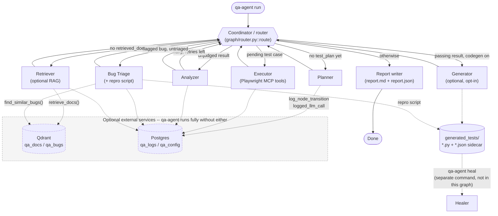

# qa-agent

An AI-powered, multi-agent QA automation system built with [LangGraph](https://github.com/langchain-ai/langgraph)
and the official [Playwright MCP](https://playwright.dev/mcp/introduction) server.

Point it at a URL and a set of requirements, and a Coordinator agent routes work through a
Planner → Executor → Analyzer → Bug Triage loop until everything is resolved, then writes a
Markdown + JSON report. An opt-in Generator step can also turn passing runs into standalone
Playwright regression scripts, which a separate Healer command can later re-validate and
re-synthesize against a live app without any further LLM-pipeline run.

## Architecture

- **Coordinator** (`graph/router.py`) -- a pure, deterministic router function. It decides the
  next agent purely from the shape of the current state (no plan yet → Planner; a test case not
  yet run → Executor; a result not yet judged → Analyzer; a flagged bug not yet triaged → Triage;
  otherwise → write the report).
- **Planner** -- turns the target URL + requirements into a structured list of test cases.
- **Executor** -- the only agent with tools bound to it. Drives a real, persistent browser session
  via Playwright MCP tools (navigate, snapshot, click, type, screenshot, ...) to run one test
  case's steps at a time.
- **Analyzer** -- judges each executed test case pass/fail/flaky, with a deterministic
  threshold-based retry for "flaky" verdicts.
- **Bug Triage** -- turns suspected-bug results into structured, GitHub-issue-ready bug reports,
  and also synthesizes a standalone Playwright repro script for each one.
- **Generator** (`agents/codegen.py`, opt-in via `--generate-regression-scripts`) -- for each
  *passing* test case, synthesizes a standalone Playwright regression script + a JSON sidecar
  (original steps, target URL) under `generated_tests/`, so the test can be re-run cheaply without
  the LLM pipeline. Not pictured below as a mandatory step -- it only runs when enabled.
- **Healer** (`qa-agent heal`, standalone CLI command, not a graph node) -- re-executes a generated
  script's original steps live, and if the app still behaves correctly but the UI changed, rewrites
  the script with freshly-resolved locators. If the app's behavior actually regressed, it reports
  that instead of silently rewriting the script.
- **Retriever** (optional RAG) -- runs once before the Planner. When Qdrant/RAG is configured, it
  retrieves relevant indexed product docs for the Planner to ground test cases in; it degrades
  silently (returns no context) when RAG isn't configured.
- **Logging** (optional, Postgres) -- every node is wrapped to record its own duration and any
  escaping error; every LLM call is timed and sized. Writes are always best-effort -- a logging DB
  outage never crashes or blocks a live run.



See [docs/architecture.md](docs/architecture.md) for the full node-by-node reference.

The core orchestration lives behind a single library entrypoint, `run_qa_session(...)`
(`core/session.py`), so the CLI is a thin wrapper and a future API/UI layer can call it directly.

## Setup

Requires Python 3.11+ and Node.js (Playwright MCP runs via `npx`).

```bash
python3.12 -m venv .venv
source .venv/bin/activate
pip install -e ".[dev]"
npx -y playwright install chromium

cp .env.example .env
# edit .env and add a free API key for your chosen provider (see below)
```

## LLM provider

Provider-agnostic by design -- swap providers via `LLM_PROVIDER` in `.env` or `--provider` on the
CLI. Defaults to **Groq**, which has a generous free API tier with good tool-calling support.

| Provider | Free tier? | Install extra | Get a key |
|---|---|---|---|
| `groq` (default) | Yes | included by default | https://console.groq.com/keys |
| `google` | Yes | `pip install -e ".[google]"` | https://aistudio.google.com/apikey |
| `anthropic` | No | `pip install -e ".[anthropic]"` | https://console.anthropic.com |
| `openai` | No | `pip install -e ".[openai]"` | https://platform.openai.com |
| `huggingface` | Yes (free Inference Providers credits) | `pip install -e ".[huggingface]"` | https://huggingface.co/settings/tokens |

Bug Triage, the Generator, and Healer default to preferring `huggingface` (see
`node_candidate_providers` in [docs/logging-and-config.md](docs/logging-and-config.md)) since
they do the pipeline's heaviest reasoning and code-synthesis work -- if `HUGGINGFACE_API_KEY`
isn't set, they automatically fail over to `groq`.

## Usage

```bash
qa-agent run --url https://example.com --requirements "Check the page loads and has a title"

qa-agent run --url https://myapp.com --requirements ./examples/requirements_example.md \
  --provider google --model gemini-2.5-flash
```

Each run writes `reports/<run-id>/report.md`, `report.json`, and any captured screenshots under
`reports/<run-id>/screenshots/`.

## Generator & Healer (optional)

Turn a passing run into a cheap, LLM-free regression suite, and keep it working as the app's UI
changes:

```bash
# Generate a standalone Playwright script for every passing test case
qa-agent run --url https://example.com --requirements "..." --generate-regression-scripts
```

Each passing test case gets `reports/<run-id>/generated_tests/<test-case-id>.py` (a self-contained
`playwright.sync_api` script, runnable on its own) plus a `.json` sidecar recording its original
steps and target URL. Every flagged bug also gets a `<bug-id>_repro.py` reproduction script in the
same directory.

```bash
# Re-validate one script, or every script under reports/, against the live app
qa-agent heal --script reports/<run-id>/generated_tests/TC-01.py
qa-agent heal --all
```

`heal` re-runs a script's original steps live through Playwright MCP. If the app still behaves
correctly but its UI changed (e.g. a button's label changed), it rewrites the script with
freshly-resolved locators (`healed`). If the app's actual behavior broke, it reports that instead
and leaves the file untouched (`regression_detected`, non-zero exit code) -- it never silently
papers over a real regression.

## RAG (optional)

The Planner can be grounded in retrieved product docs, and Bug Triage can look up similar
previously-known bugs, via [Qdrant](https://qdrant.tech/) + Google's free `text-embedding-004`
embeddings. This is entirely optional -- leave the `.env` RAG fields blank and `qa-agent` runs
exactly as without it.

```bash
pip install -e ".[rag]"
```

1. Create a free [Qdrant Cloud](https://cloud.qdrant.io) cluster and grab its URL + API key.
2. In `.env`, set `QDRANT_URL`, `QDRANT_API_KEY`, and `GOOGLE_API_KEY` (same free key as the
   `google` LLM provider above -- get one at https://aistudio.google.com/apikey).
3. Seed the knowledge base:

```bash
qa-agent ingest-docs ./docs --chunk-size 1000 --chunk-overlap 100
```

See [docs/rag.md](docs/rag.md) for the full guide (collection schemas, embedding details,
ingestion examples, and how retrieval degrades when unconfigured).

## Logging + config (optional, Postgres)

Every run can log structured history -- run outcomes, per-node transitions with duration,
per-LLM-call timing/size, and errors with stack traces -- to Postgres, and settings can be
managed from a second Postgres database instead of only `.env`. Both are entirely optional --
leave the `.env` Postgres fields blank and `qa-agent` behaves exactly as without them.

```bash
pip install -e ".[db]"
```

No local Postgres needed -- point `QA_LOGS_DATABASE_URL`/`QA_CONFIG_DATABASE_URL` in `.env` at a
free managed Postgres project (e.g. [Neon](https://neon.tech)) instead. See
[docs/logging-and-config.md#local-setup](docs/logging-and-config.md#local-setup) for the full
steps (create a project, add a second `qa_config` database, copy both connection strings). Schema
is created automatically on first use -- `qa-agent db-init` is available if you want to set it up
explicitly instead.

```bash
qa-agent config set max_retries 3       # overrides MAX_RETRIES from .env once the config DB is reachable
```

See [docs/logging-and-config.md](docs/logging-and-config.md) for the full guide (table schemas,
the config-precedence chain, and the full `config set/get/list` reference).

## Web UI (optional)

A local, dark-themed Flask UI for everything above -- starting runs, browsing reports, editing
config, and triggering the healer -- without touching the terminal:

```bash
pip install -e ".[web]"
qa-agent web
```

Then open `http://127.0.0.1:5000`. Binds to loopback only by default. See
[docs/web.md](docs/web.md) for the full guide.

## Development

```bash
pytest                       # unit tests, mocked LLM/MCP -- no API key or Node needed
python scripts/check_mcp.py  # manual sanity check: launches Playwright MCP, lists real tools
ruff check src tests scripts
```

Tests marked `@pytest.mark.integration` spawn real subprocesses or call real APIs and are excluded
from the default `pytest` run; run them explicitly with `pytest -m integration` once you have an
API key and Node set up.

For the full CLI command reference (flags, exit codes, examples for every command), see
[docs/cli.md](docs/cli.md).
