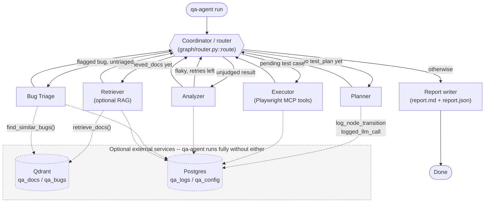

# Architecture

[← back to README](../README.md)

This is the deep-dive reference for the core multi-agent QA pipeline: the Coordinator/router
pattern, the shape of state that flows through the graph, and what each node reads and returns.
For the optional RAG and Postgres logging/config features, see [docs/rag.md](rag.md) and
[docs/logging-and-config.md](logging-and-config.md).

## Overview

`qa-agent` is a [LangGraph](https://github.com/langchain-ai/langgraph) `StateGraph` over a single
TypedDict, `QAState`. There is no explicit "status" field driving the pipeline -- a pure,
deterministic router function (the **Coordinator**) decides the next node purely from the *shape*
of the current state (is there a plan yet? a pending test case? an unjudged result?). The graph is
built and run by `src/qa_agent/graph/build.py::build_graph(...)`, and the library entrypoint that
sets everything up and invokes it is `src/qa_agent/core/session.py::run_qa_session(...)`. The CLI's
`run` command (`src/qa_agent/cli.py`) is a thin wrapper over that function, so a future API or UI
layer can call `run_qa_session` directly.

## The Coordinator / router

`src/qa_agent/graph/router.py::route(state) -> NodeName` is the single dispatcher, wired in as both
the graph's conditional entry point and the conditional-edge function from every worker node. It
checks state shape in a fixed order:

1. `state["retrieved_docs"] is None` → `"retriever"` (only ever true once, at the very start of a run).
2. `state["test_plan"] is None` → `"planner"`.
3. Any test case in `test_plan` with no matching `test_results` entry → `"executor"`.
4. Any `test_results` entry with `verdict is None` → `"analyzer"`.
5. Any `test_results` entry with `suspected_bug=True` and no matching `bugs` entry → `"triage"`.
6. Otherwise → `"report"`.

Because `route` is re-invoked after *every* node (via `add_conditional_edges` on all five worker
nodes, plus as the conditional entry point), there's no need for explicit "next node" edges between
workers -- the graph always routes back through the Coordinator, which re-derives the correct next
step from whatever the previous node changed in state.

## State shape (`QAState`)

Defined in `src/qa_agent/graph/state.py` as a `TypedDict`:

| Field | Type | Purpose |
|---|---|---|
| `run_id` | `str` | Unique per-run id (see [docs/logging-and-config.md](logging-and-config.md) for why it has a random suffix). |
| `target_url` | `str` | The URL under test. |
| `requirements_raw` | `str` | The raw requirements text (inline string or loaded file contents). |
| `llm_provider`, `llm_model` | `str` | The resolved provider/model actually used for this run (not just whatever the caller passed, which may be `None`). |
| `screenshot_dir` | `str` | Where the Executor saves screenshots. |
| `max_retries` | `int` | Retry budget for `"flaky"` verdicts. |
| `retry_counts` | `dict[str, int]` | Per-test-case retry counter, keyed by test case id. |
| `retrieved_docs` | `list[RetrievedDoc] \| None` | `None` until the Retriever runs once; `[]` if RAG is unconfigured or found nothing. |
| `test_plan` | `list[TestCase] \| None` | `None` until the Planner runs. |
| `test_results` | `list[TestCaseResult]` | Grows as the Executor runs test cases; entries are judged in place by the Analyzer. |
| `bugs` | `list[Bug]` | Grows as the Triage node processes flagged results. |
| `errors` | `list[str]` | Reserved; not currently written to by any node. |
| `started_at` | `str` | ISO timestamp, set once at session start. |
| `report_markdown_path`, `report_json_path` | `str \| None` | Set by the `report` node at the end of a run. |

Nested Pydantic models, also in `graph/state.py`:

- **`TestCase`**: `id`, `title`, `priority` (`"high"|"medium"|"low"`), `steps` (list of imperative strings, no selectors/code -- the Executor interprets them).
- **`StepResult`**: `description`, `status` (`"pass"|"fail"`), `tool_calls` (raw transcript, only populated on the first step of a test case), `error`, `screenshot_path`.
- **`TestCaseResult`**: `test_case_id`, `title`, `priority`, `steps: list[StepResult]`, `verdict` (`"pass"|"fail"|"flaky"|None`), `reasoning`, `suspected_bug`, `started_at`, `finished_at`.
- **`Bug`**: `id` (`BUG-NN`), `title`, `severity`, `related_test_case_id`, `repro_steps`, `expected`, `actual`, `suspected_root_cause`, `screenshot_refs`, `similar_bug_refs` (populated from RAG lookups, see [docs/rag.md](rag.md)).

## Graph wiring (`graph/build.py`)

```python
def build_graph(executor_node, llm, rag_service, log_service) -> CompiledStateGraph:
```

- `executor_node` arrives pre-built (it closes over the executor's ReAct agent, which itself closes
  over the live Playwright MCP tool session) -- everything else is built inside `build_graph` from
  the shared `llm`.
- `rag_service`/`log_service` are always real instances, never `None` -- when RAG or Postgres
  logging isn't configured, they simply no-op (see [docs/rag.md](rag.md) and
  [docs/logging-and-config.md](logging-and-config.md)), so `build_graph` and every node factory
  never special-case "is this feature enabled."
- Every node is wrapped by `_with_node_logging(name, fn, log_service)` before `graph.add_node(...)`.
  This wrapper times the node's execution, calls `log_service.log_node_transition(...)` on both
  success and failure, and on failure also calls `log_service.log_error(...)` **then re-raises**.
  This is the one error-logging boundary in the whole pipeline that does not swallow exceptions --
  a real failure still propagates all the way to the CLI, which exits non-zero.
- `graph.set_conditional_entry_point(route, route_map)` plus `graph.add_conditional_edges(node, route, route_map)`
  for every worker node (`retriever`, `planner`, `executor`, `analyzer`, `triage`) routes every
  transition through the Coordinator. `report` has a plain edge to `END`.

## Node-by-node reference

- **Retriever** (`agents/retriever.py::make_retriever_node`) -- runs once, first. Builds a query from
  `f"{target_url}\n\n{requirements_raw}"` and calls `rag_service.retrieve_docs(query)`. Always
  returns a list (possibly empty) into `retrieved_docs`. No LLM call. See [docs/rag.md](rag.md).
- **Planner** (`agents/planner.py::make_planner_node`) -- one structured-output LLM call
  (`TestPlanResponse` → `list[TestCase]`), prompted with the target URL, requirements, and any
  retrieved docs formatted as a block. Wrapped in `logged_llm_call` for timing/size logging.
- **Executor** (`agents/executor.py::make_executor_node`) -- the only node with tools bound. Drives
  a LangChain ReAct agent (`langchain.agents.create_agent`) bound to live Playwright MCP tools,
  running one pending test case's steps per invocation. After the call, it decodes any
  `browser_take_screenshot` image blocks from the tool-call transcript (`extract_screenshots`),
  flattens the tool-call/result transcript (`extract_tool_calls`, attached only to the first
  `StepResult` to avoid duplicating it per step), and appends a `TestCaseResult`.
- **Analyzer** (`agents/analyzer.py::make_analyzer_node`) -- one structured-output LLM call
  (`AnalysisResponse`: verdict + reasoning + `suspected_bug`) per unjudged result. See "the retry
  loop" below for its `"flaky"` handling.
- **Bug Triage** (`agents/triage.py::make_triage_node`) -- for a flagged, untriaged result: calls
  `rag_service.find_similar_bugs(f"{title}\n{reasoning}")` for context, then one structured-output
  LLM call (`TriageResponse`) to produce a GitHub-issue-shaped `Bug`. `similar_bug_refs` is set from
  the RAG lookup results directly (not LLM-authored), same precedent as `screenshot_refs`.
- **Report writer** (`graph/build.py::_make_report_node`, delegating to `report/writer.py::write_report`)
  -- builds a `QAReport`, renders `report.md` (Jinja2) and `report.json`, and writes both under
  `reports/<run_id>/`.

## The retry loop

There is no explicit graph edge for retries. When the Analyzer judges a result `"flaky"` and
`_should_retry` (a deterministic threshold check: `retry_counts.get(test_case_id, 0) < max_retries`)
says the budget isn't exhausted, the analyzer node **drops that result** from the `test_results` it
returns and bumps `retry_counts`. On the next pass through the Coordinator, that test case once
again has no matching `test_results` entry, so `route()` naturally sends it back to `"executor"`.
This is the `Analyzer --"flaky, retries left"--> Coordinator` edge in the diagram below -- a
router-mediated loop driven by state shape, not a literal graph edge back to `executor`.

## Library entrypoint (`core/session.py::run_qa_session`)

Resolves effective settings (`get_effective_settings()`, see
[docs/logging-and-config.md](logging-and-config.md)), builds the LLM, `RagService`, and
`LogService`, opens a `PlaywrightMCPSession`, builds the executor agent/node and the graph, and runs
`graph.ainvoke(initial_state, config={"recursion_limit": recursion_limit})`. Logs `log_run_start`
before entering the session and `log_run_end` in a `finally` block regardless of success or
failure, then returns a `RunResult` (`run_id`, `overall_status`, report paths, `test_results`,
`bugs`).

## Reporting

`report/writer.py::overall_status(state)`: `"fail"` if any test case failed; `"pass"` if every
verdict is `"pass"`; otherwise `"flaky"` (or `"fail"` if there are no verdicts at all, e.g. an empty
plan). `write_report(state, run_dir)` writes `report.md` and `report.json` under
`reports/<run_id>/`, alongside any screenshots the Executor saved under
`reports/<run_id>/screenshots/`.

## Full architecture diagram



## Test coverage

- `tests/test_router.py` -- routing decisions for every state shape, including the retry loop.
- `tests/test_planner_node.py`, `tests/test_analyzer_node.py`, `tests/test_triage_node.py` -- node
  behavior with hand-rolled stub LLMs.
- `tests/test_executor_parsing.py` -- `extract_tool_calls`/`extract_screenshots` against synthetic
  message transcripts.
- `tests/test_report.py`, `tests/test_llm_factory.py`, `tests/test_ids.py`.

The repo has no mocking framework (no `unittest.mock`, no `pytest-mock`) -- tests use small
hand-rolled stub classes (e.g. a `_StubLLM`/`_StubStructuredLLM` pair) instead. Keep new tests
consistent with this convention.
