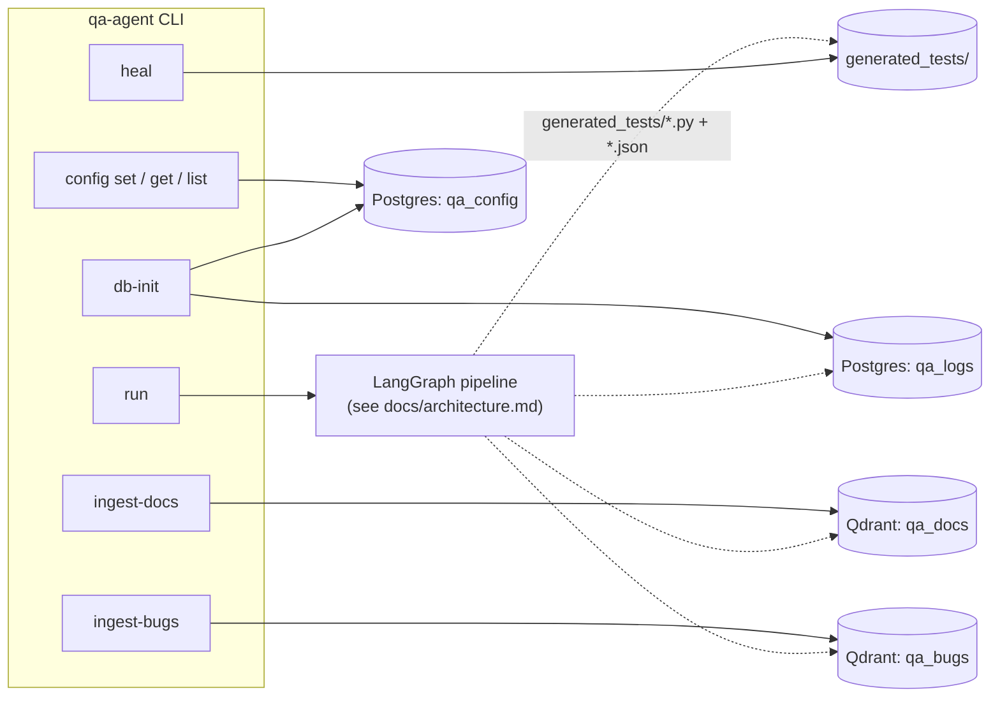

# CLI reference

[← back to README](../README.md)

`qa-agent` is a [Typer](https://typer.tiangolo.com/) app (`src/qa_agent/cli.py`), installed as the
`qa-agent` console script. This page is a pure command reference -- for *why* behind any given
command, see [docs/architecture.md](architecture.md), [docs/rag.md](rag.md), or
[docs/logging-and-config.md](logging-and-config.md).



## `qa-agent run`

Run an AI-powered QA session against a target URL.

| Flag | Default | Description |
|---|---|---|
| `--url` | *(required)* | Target URL to test. |
| `--requirements` | *(required)* | Natural-language requirements, or a path to a file containing them. |
| `--provider` | from config/settings | LLM provider: `groq` (default), `google`, `anthropic`, `openai`, or `huggingface`. |
| `--model` | provider's default | Override the provider's default model. |
| `--headless` / `--no-headless` | from config/settings | Run the browser headless. |
| `--max-retries` | from config/settings | Retries for test cases judged `"flaky"`. |
| `--reports-dir` | from config/settings | Directory to write reports into. |
| `--generate-regression-scripts` / `--no-generate-regression-scripts` | from config/settings | Generate a standalone Playwright regression script for every passing test case, under `generated_tests/`. |
| `-v` / `--verbose` | off | Verbose output. |

Precedence for `--headless`/`--max-retries`/`--reports-dir`/`--generate-regression-scripts`: **CLI
flag (if passed) → `qa_config` DB (if reachable) → `.env`/hardcoded default** -- see
[docs/logging-and-config.md](logging-and-config.md#config-precedence-chain).

```bash
qa-agent run --url https://example.com --requirements "Check the page loads and has a title"

qa-agent run --url https://myapp.com --requirements ./examples/requirements_example.md \
  --provider google --model gemini-2.5-flash

qa-agent run --url https://myapp.com --requirements ./examples/requirements_example.md \
  --generate-regression-scripts
```

Exit code: `0` if `overall_status == "pass"`, else `1`.

## `qa-agent heal`

Re-execute a generated regression script's original steps against the live app and, if it still
passes, re-synthesize its locators from a fresh accessibility-tree snapshot. Reads the script's
JSON sidecar, not the original run's state -- can be run long after, and independent of, the
`qa-agent run` that produced it. See
[docs/architecture.md#generator--healer](architecture.md#generator--healer).

| Flag | Default | Description |
|---|---|---|
| `--script` | *(one of `--script`/`--all` required)* | Path to one `generated_tests/<id>.py` script to heal. |
| `--all` | off | Heal every generated script found under `--reports-dir`. |
| `--reports-dir` | from config/settings | Where to scan for generated scripts (used with `--all`). |
| `--provider` | from config/settings | LLM provider override for healing. |
| `--model` | provider's default | Model override for healing. |

```bash
qa-agent heal --script reports/20260101T000000Z-abcd1234/generated_tests/TC-01.py
qa-agent heal --all
```

Prints one status line per script: `healed` (green, locators re-resolved and file updated),
`still_valid` (dim, re-execution passed and nothing changed), or `regression_detected` (red, the
live re-execution itself failed -- the file is left untouched).

Exit code: `0` if every script was `healed`/`still_valid`; `1` if any was `regression_detected`, or
if neither `--script` nor `--all` was given, or if no generated scripts were found.

## `qa-agent ingest-docs`

Ingest product docs into the `qa_docs` Qdrant collection for the Planner to retrieve from.

| Argument/Flag | Default | Description |
|---|---|---|
| `PATH` | *(required)* | A `.md`/`.txt` file, or a directory of them, to index. |
| `--chunk-size` | `1000` | Max characters per chunk. |
| `--chunk-overlap` | `100` | Overlap between consecutive chunks. |

```bash
qa-agent ingest-docs ./docs --chunk-size 1000 --chunk-overlap 100
```

Exit code: `1` with a red error message if RAG isn't configured. See [docs/rag.md](rag.md) for
the collection schema and `RagService` contract.

## `qa-agent ingest-bugs`

Seed the `qa_bugs` Qdrant collection for Triage's known-issue lookup.

| Argument | Default | Description |
|---|---|---|
| `PATH` | *(required)* | A JSON file: a list of `{id?, title, description, severity?}` records. |

```bash
qa-agent ingest-bugs ./known_bugs.json
```

Exit code: `1` with a red error message if RAG isn't configured. See [docs/rag.md](rag.md).

## `qa-agent config set`

Set a config value in the `qa_config` DB (stored as JSON).

| Argument | Description |
|---|---|
| `KEY` | Setting name -- must match a `Settings` field (e.g. `max_retries`) to take effect. |
| `VALUE` | Value to store -- parsed as JSON if possible (`3` → number, `false` → boolean), else stored as a raw string. |

```bash
qa-agent config set max_retries 3
qa-agent config set playwright_headless false
```

Exit code: `1` with a red error message if the config DB isn't configured. See
[docs/logging-and-config.md](logging-and-config.md) for the schema and precedence chain.

## `qa-agent config get`

Get a config value from the `qa_config` DB.

| Argument | Description |
|---|---|
| `KEY` | Setting name to look up. |

```bash
qa-agent config get max_retries
```

Exit code: `1` with a yellow "not set" message if the key has no stored value (this is the same
whether the key was never set or the config DB itself is unreachable -- either way, the effective
value falls back to `.env`/default).

## `qa-agent config list`

List every config value currently stored in the `qa_config` DB.

```bash
qa-agent config list
```

Exit code: `1` with a yellow error message if the config DB isn't configured. Prints a dim
"no config values set" message (exit `0`) if the DB is reachable but empty.

## `qa-agent db-init`

Explicitly (re-)create the `qa_logs`/`qa_config` schemas.

Not required for normal use -- `ConfigService`/`LogService` ensure their own schema automatically
on first connect -- but useful for decoupling ops/CI setup from a first `qa-agent run`/
`config set`. Prints a per-database status line; skips (with a dim message) any database whose
connection string isn't set. See [docs/logging-and-config.md](logging-and-config.md).

```bash
qa-agent db-init
```

## `qa-agent web`

Launch the local web UI (run sessions, browse reports, edit config, trigger heal) -- see
[docs/web.md](web.md) for the full guide.

| Flag | Default | Description |
|---|---|---|
| `--host` | `127.0.0.1` | Interface to bind. |
| `--port` | `5000` | Port to listen on. |
| `--debug` | off | Flask debug mode. Refused unless `--host` is loopback. |

```bash
qa-agent web
```

Exit code: `1` if Flask isn't installed (run `pip install -e ".[web]"`), or if `--debug` is
combined with a non-loopback `--host`.

## Exit code summary

| Command | Exit `0` | Exit `1` |
|---|---|---|
| `run` | `overall_status == "pass"` | `overall_status` is `"fail"` or `"flaky"` |
| `heal` | every script `healed`/`still_valid` | any `regression_detected`, no scripts found, or neither `--script` nor `--all` given |
| `ingest-docs` / `ingest-bugs` | ingestion succeeded | RAG not configured |
| `config set` | value stored | config DB not configured |
| `config get` | key found | key not set (DB unreachable or just unset) |
| `config list` | printed (even if empty) | config DB not configured |
| `db-init` | always `0` | -- |
| `web` | server exits normally (Ctrl+C) | Flask not installed, or `--debug` with a non-loopback `--host` |
